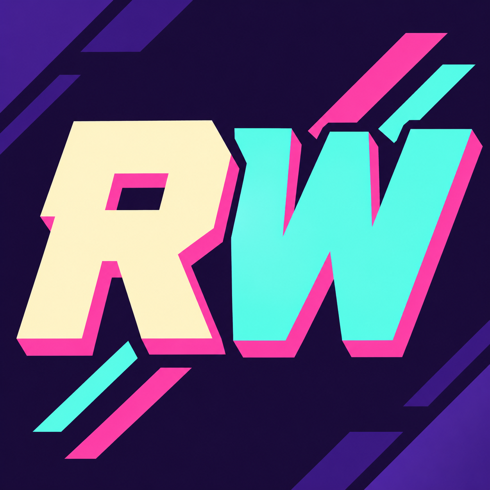

# RhythmWare

**Un videojuego de ritmo para practicar conceptos de ciberseguridad.**

RhythmWare combina una campaña de tres niveles, un tutorial guiado y preguntas de la Academia SOC. Esta es una **beta para pruebas y evaluación académica**.

**[Descargar para Windows de 64 bits](https://github.com/BlackModerm10/RhythmWare/releases/download/v0.2.0-beta.3/RhythmWare-Windows-x64.zip)** · [Ver la versión publicada](https://github.com/BlackModerm10/RhythmWare/releases/tag/v0.2.0-beta.3)

## Participar en la experiencia

Sigue este orden para que podamos comparar tus conocimientos y tu experiencia con el juego:

1. **Antes de abrir el juego, completa el [pretest: conocimientos previos y expectativas](https://forms.gle/tWyXDhHbhvTkP41b9).**
2. Descarga el ZIP, extrae toda su carpeta y abre `RhythmWare.exe`.
3. Elige un alias, configura el audio y comienza con **Sara / Tutorial guiado**. Después prueba los otros niveles de la campaña y la Academia SOC.
4. **Al terminar tu sesión, completa el [postest: experiencia después de jugar](https://forms.gle/tZ7bom8BJFBErc5u6).**

Si los formularios solicitan un identificador, utiliza el mismo en ambos. Los formularios se completan fuera del juego; las respuestas de la Academia SOC son un registro distinto.

## Descargar y ejecutar

1. Usa el botón de descarga anterior o entra en **Releases** y busca **RhythmWare-Windows-x64.zip**.
2. Haz clic derecho sobre el archivo y elige **Extraer todo**.
3. Abre la carpeta extraída `RhythmWare` y ejecuta **RhythmWare.exe**. Windows puede mostrarlo como `RhythmWare` si oculta las extensiones.

Conserva `RhythmWare_Data`, `MonoBleedingEdge`, `D3D12` y las DLL junto al ejecutable. No ejecutes el juego desde dentro del ZIP ni muevas únicamente el `.exe`.

Necesitas un equipo con **Windows de 64 bits**, teclado o mando compatible y salida de audio. No necesitas instalar Unity ni crear una cuenta de GitHub o Supabase. Internet permite enviar resultados y consultar la clasificación global; las partidas se pueden jugar sin conexión.

Los paquetes automáticos de GitHub llamados **Source code (zip/tar.gz)** contienen la documentación de este repositorio, no el juego. Descarga el archivo **RhythmWare-Windows-x64.zip**.

## Primer inicio

- Crea un perfil con un **alias**, sin correo ni contraseña.
- Realiza la calibración de audio para ajustar la sincronización a tu equipo. Puedes repetirla en Configuración.
- El volumen maestro inicial es **30%**. En Configuración puedes cambiar volumen, resolución, modo de pantalla, teclado y mando.
- Tu acceso, ajustes y progreso se recuerdan en este PC.

## Controles predeterminados

| Acción | Control |
|---|---|
| Carriles de izquierda a derecha | **D · F · ESPACIO · J · K** |
| Nota sostenida | Mantén pulsada la tecla del carril |
| Pausar / volver | **Esc** |
| Reducir / aumentar velocidad de notas | **F3 / F4**, de 0,5× a 8× |
| Volumen general durante la partida | Rueda del ratón |
| Volumen de efectos durante la partida | **Shift + rueda** |

Puedes reasignar las teclas y configurar un mando desde Configuración. La velocidad de notas modifica la lectura del carril; no cambia la velocidad de la canción.

## Campaña

| Etapa | Contenido |
|---|---|
| **Sara** | Tutorial guiado y primera misión |
| **[@__@]** | Defensa de la red, nivel intermedio |
| **Dragon and Girl and Decoherence** | Batalla contra Bonzi Buddy |

La Academia SOC, los casos de recuperación y las explicaciones complementan la parte musical. Empieza por el tutorial aunque ya hayas jugado otros juegos de ritmo.

## Resultados y privacidad

La clasificación global muestra el alias con su etiqueta y las estadísticas de tu mejor victoria por mapa. El historial de intentos y las respuestas SOC se envían de forma privada al responsable de la experiencia para su análisis; no forman parte de la tabla pública.

Sin conexión, el juego conserva los registros pendientes y reintenta enviarlos al recuperar el acceso al servicio. No borres tu perfil local mientras tenga datos pendientes.

En **Configuración → Perfil** puedes consultar el código privado de recuperación. Guárdalo si necesitas recuperar tu identidad en otro equipo, después de su primera sincronización. **No publiques ese código ni lo incluyas en capturas.**

Consulta [PRIVACIDAD.md](PRIVACIDAD.md) para conocer qué se guarda y qué aparece públicamente.

## Si algo no funciona

- **El juego no abre:** confirma que extrajiste el ZIP completo y que todas sus carpetas siguen junto al ejecutable.
- **Las notas no coinciden con el sonido:** repite la calibración de audio en Configuración.
- **La pantalla tiene un tamaño incómodo:** ajusta resolución y modo ventana/pantalla completa en Configuración → Imagen.
- **El audio está muy fuerte:** utiliza la rueda del ratón durante la partida o los controles de volumen en Configuración.
- **No aparecen resultados globales:** comprueba la conexión y el estado del perfil. La clasificación publica victorias; los intentos fallidos se guardan en el historial privado.

Para informar de un fallo, utiliza [Issues](https://github.com/BlackModerm10/RhythmWare/issues). Describe qué ocurrió, en qué nivel y cómo repetirlo. Evita adjuntar datos personales, códigos de recuperación o archivos de investigación.

## Sobre este repositorio

Este es el **repositorio público de distribución**: contiene la documentación para jugadores y las descargas compiladas en Releases. El proyecto fuente de Unity, las herramientas internas, la administración del servicio y los datos experimentales no se publican aquí.

[Historial de versiones](CAMBIOS.md) · [Créditos](CREDITOS.md)
